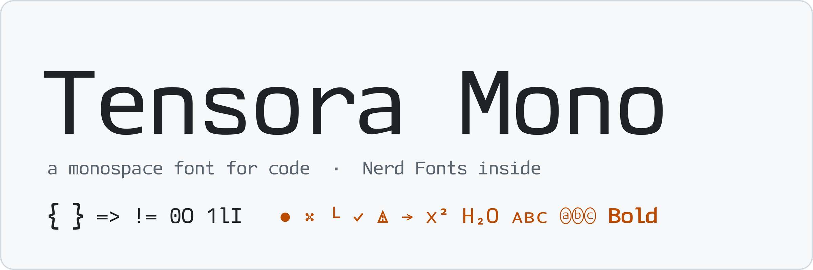
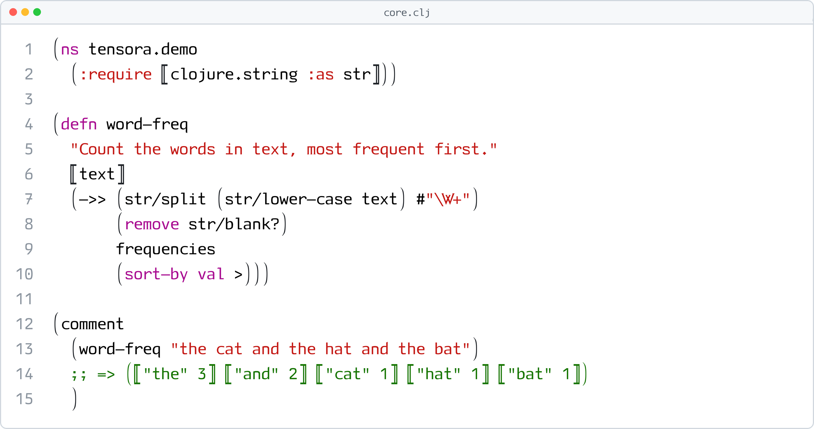
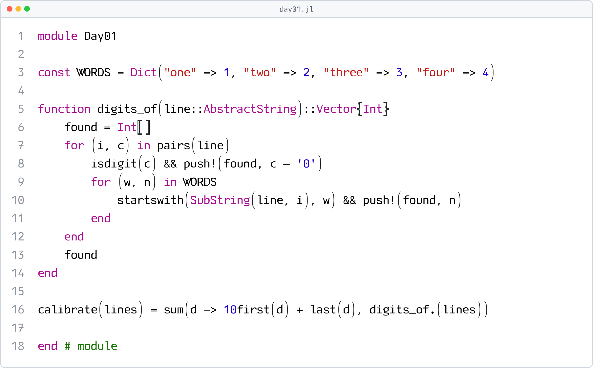
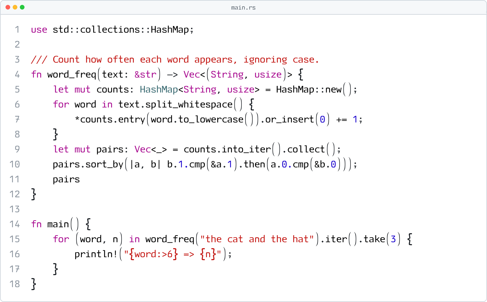
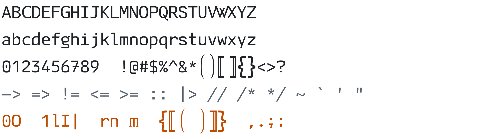
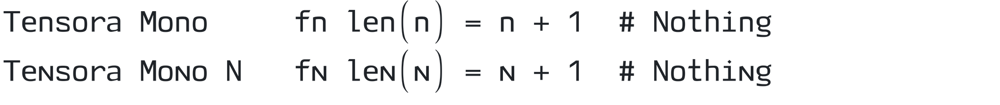
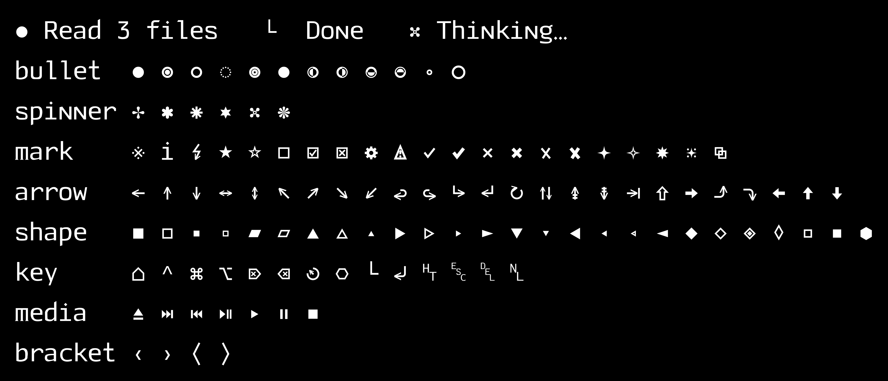
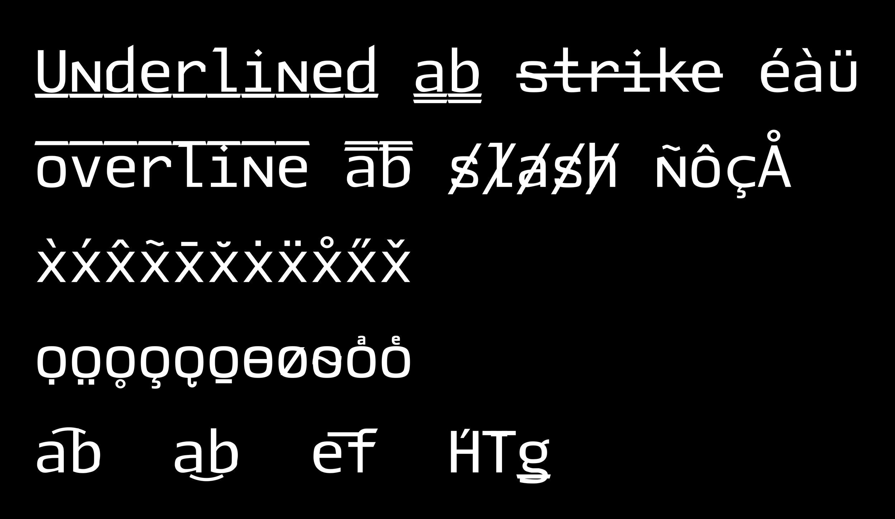
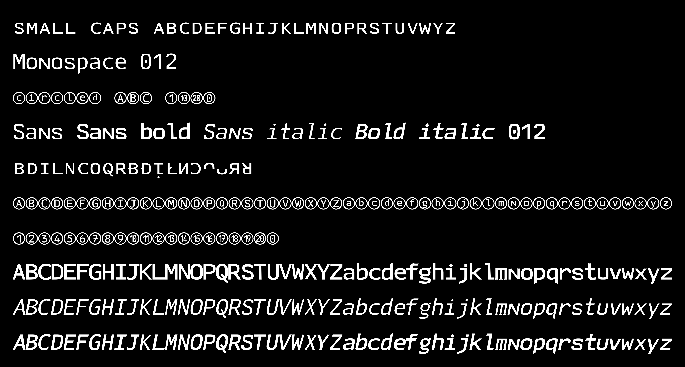
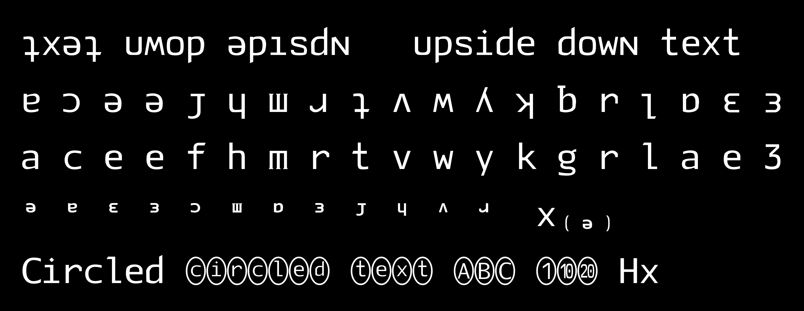

<p align="center">
  <picture>
    <source media="(prefers-color-scheme: dark)" srcset="assets/readme/banner-dark.png">
    
  </picture>
</p>

<p align="center">
  A monospace font for programming languages, with the Nerd Fonts icons built in.
</p>

<p align="center">
  <a href="https://github.com/jasonjckn/tensora-mono-font/releases/latest"></a>
  <a href="LICENSE"></a>
</p>

<p align="center">
  <a href="https://github.com/jasonjckn/tensora-mono-font/releases/latest"><b>Download</b></a> ·
  <a href="#in-use">In use</a> ·
  <a href="#two-variants">Two variants</a> ·
  <a href="#unicode-coverage">Unicode coverage</a> ·
  <a href="#install">Install</a>
</p>

## In use

<picture>
  <source media="(prefers-color-scheme: dark)" srcset="assets/readme/code-core-dark.png">
  
</picture>

<picture>
  <source media="(prefers-color-scheme: dark)" srcset="assets/readme/code-day01-dark.png">
  
</picture>

<picture>
  <source media="(prefers-color-scheme: dark)" srcset="assets/readme/code-main-dark.png">
  
</picture>

## Character set

<picture>
  <source media="(prefers-color-scheme: dark)" srcset="assets/readme/specimen-dark.png">
  
</picture>

Every glyph is one cell (600 units) wide, and the look-alikes are easy to tell apart: `0O`, `1lI|`, `rn m`.

## Two variants

Two fonts are available. **Tensora Mono N** is the same as **Tensora Mono**, but its `n` is a small capital `ɴ`.

<picture>
  <source media="(prefers-color-scheme: dark)" srcset="assets/readme/variants-dark.png">
  
</picture>

## Unicode coverage

Beyond ASCII, the font draws the characters that terminal output and Unicode "styled text" use, so editors don't fall back to other fonts with different widths and heights:

- **Nerd Fonts 3.5.1** icons (10,610)
- **Claude Code's UI symbols**: bullets, spinner, marks, arrows, keys, media (v14)
- **Combining marks** U+0300–U+036F, drawn over the previous cell: u̲n̲d̲e̲r̲l̲i̲n̲e̲, s̶t̶r̶i̶k̶e̶, o̅v̅e̅r̅l̅i̅n̅e̅ (v15)
- **Small capitals**, **circled letters and digits**, **math sans** (𝗯𝗼𝗹𝗱, 𝘪𝘵𝘢𝘭𝘪𝘤) and **math monospace** (v15)
- **Superscripts, subscripts and modifier letters**: xⁿ⁺¹, H₂O, ˢᵘᵖᵉʳ (v16)
- **Turned letters** for upside-down text: ʇxǝʇ uʍop ǝpısdn (v17)

#### v14: Claude Code's symbols



#### v15: combining marks



#### v15: small capitals, circled and math letters



#### v16: superscripts and subscripts


#### v17: turned letters and bigger circled glyphs



## Install

Download `TensoraMono.otf` and/or `TensoraMonoN.otf` from the [latest release](https://github.com/jasonjckn/tensora-mono-font/releases/latest).

- **macOS:** open them in Font Book, or copy them to `~/Library/Fonts`.
- **Linux:** copy them to `~/.local/share/fonts`, then run `fc-cache -f`.

Then set the family name, `Tensora Mono` or `Tensora Mono N`, in your editor or terminal:

```elisp
;; Doom Emacs
(setq doom-font (font-spec :family "Tensora Mono N" :size 14))
```

```jsonc
// VS Code settings.json
"editor.fontFamily": "Tensora Mono N"
```

```ini
# Ghostty
font-family = Tensora Mono N
```

## License

[MIT](LICENSE). Maintainers: see [RELEASING.md](RELEASING.md) for how a release is built and published.
