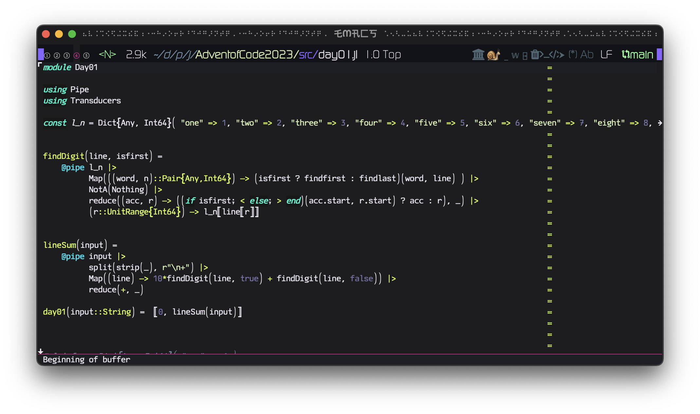
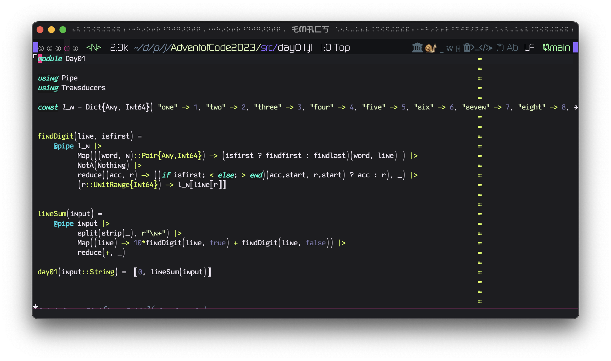
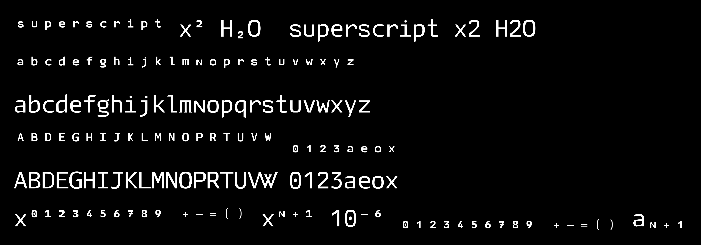

# 

#### Tensora Mono (nerd font), a font intended for programming languages. 

2 variants available 

* 'Tensora Mono'

  

* 'Tensora Mono N' - identical to the above, but has a small caps 'N'
  

#### v16: superscripts and subscripts

#### Releasing a new version

1. Save the sources as `src/TensoraMono_vN.sfd` and `src/TensoraMono_N_vN.sfd`, and build both OTFs into `font_releases/<YYYY-MM-DD>-vN/`.
2. Render a preview of the new glyphs with `hb-view` at `--font-size=160` or larger (`--margin=96 --line-space=72`), white on black (`--background=000000 --foreground=FFFFFF`), so it stays sharp when zoomed. Save it as `assets/tensora-mono-vN-<topic>.png` and show it inline in this README, above this section.
3. Commit and push, then publish a GitHub release tagged `vN` with both OTFs and that preview image (`gh release create vN --target main ...`).
4. Install the new OTFs in both places:
   - `~/Library/Fonts/` (then `fc-cache -f ~/Library/Fonts`)
   - `~/.local/share/init/fonts/`
   
   Running Emacs sessions keep the old font until they restart.
